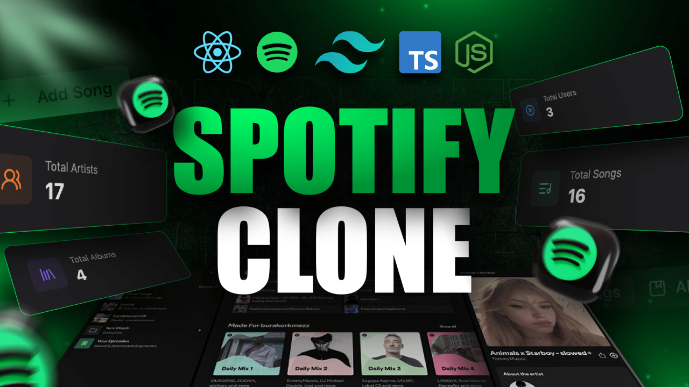

# Realtime Music Streaming App

A full-stack music streaming app with real-time chat, live online status, and a
"what friends are listening to" feed — built with React + TypeScript on the
frontend and Node.js/Express, MongoDB and Socket.io on the backend.



## Features

- **Music playback** — play, pause, next/previous, volume control, and album queues.
- **Real-time chat** — one-to-one messages delivered instantly over Socket.io and stored in MongoDB.
- **Live presence** — online/offline status and each user's current song, broadcast to everyone in real time.
- **Admin dashboard** — create and delete songs and albums, with audio and image uploads to Cloudinary.
- **Analytics** — totals for songs, albums, users and unique artists, computed with MongoDB aggregation.
- **Authentication** — Clerk sign-in (OAuth), with role checks on admin routes.

## Tech stack

| Layer       | Choice                                                               |
|-------------|----------------------------------------------------------------------|
| Frontend    | React 18, TypeScript, Vite, Tailwind CSS, shadcn/ui (Radix), Zustand |
| Backend     | Node.js, Express                                                     |
| Real time   | Socket.io                                                            |
| Database    | MongoDB with Mongoose                                                |
| Auth        | Clerk                                                                |
| Media       | Cloudinary (audio and image storage)                                 |

## Architecture

```
 React + Zustand (frontend)
      │  REST (axios)                 │  WebSocket (socket.io-client)
      ▼                               ▼
 Express API  ───────────────►  Socket.io server
  /api/songs, /albums,            user_connected / disconnect
  /users, /admin, /stats          update_activity → activity_updated
      │                           send_message → receive_message
      ▼                               │
 MongoDB (songs, albums, users, messages)  ◄──┘ messages persisted
      │
 Cloudinary (audio + cover uploads from the admin dashboard)
```

## How it works

- **Auth:** Clerk handles sign-in. On first login, a callback creates the user in
  MongoDB. Protected routes check `req.auth.userId`, and admin routes also check
  the user's email against `ADMIN_EMAIL`.
- **Real-time presence:** the Socket.io server keeps an in-memory map of online
  users and their current activity. Whenever a user plays, pauses or skips a
  song, the frontend emits `update_activity`, and the server broadcasts it to all
  connected clients.
- **Chat:** messages are saved to MongoDB, then pushed to the receiver's socket if
  they're online. Message history is loaded over REST.
- **Uploads:** the admin dashboard uploads audio and cover art through
  `express-fileupload` (10 MB limit) to Cloudinary. An hourly cron job clears the
  temporary upload folder.
- **Discovery:** featured, "made for you" and trending sections use MongoDB's
  `$sample` aggregation; the stats page uses `$unionWith` and `$group` to count
  unique artists across songs and albums.

## Run it locally

1. Clone the repo:
   ```
   git clone https://github.com/rushabhrn/Spotify-clone.git
   cd Spotify-clone
   ```
2. Create `backend/.env`:
   ```
   PORT=5000
   MONGODB_URI=your_mongodb_connection_string
   ADMIN_EMAIL=your_admin_email
   NODE_ENV=development

   CLOUDINARY_API_KEY=...
   CLOUDINARY_API_SECRET=...
   CLOUDINARY_CLOUD_NAME=...

   CLERK_PUBLISHABLE_KEY=...
   CLERK_SECRET_KEY=...
   ```
3. Create `frontend/.env.local`:
   ```
   VITE_CLERK_PUBLISHABLE_KEY=...
   ```
4. Start the backend (optionally seed sample data first):
   ```
   cd backend
   npm install
   npm run seed:albums
   npm run dev
   ```
5. In another terminal, start the frontend:
   ```
   cd frontend
   npm install
   npm run dev
   ```

Never commit your `.env` files.

## Project structure

```
Spotify-clone/
├── backend/
│   └── src/
│       ├── controller/   # Route handlers (songs, albums, admin, users, stats, auth)
│       ├── routes/       # Express routers
│       ├── models/       # Mongoose schemas (Song, Album, User, Message)
│       ├── middleware/   # Auth and admin checks
│       ├── lib/          # MongoDB, Cloudinary and Socket.io setup
│       └── seeds/        # Sample songs and albums
└── frontend/
    └── src/
        ├── pages/        # Home, album, chat, admin, auth callback, 404
        ├── layout/       # Main layout, sidebar, audio player, friends activity
        ├── stores/       # Zustand stores (auth, chat, music, player)
        └── components/   # Shared and UI components
```

## Known limitations

- Online presence is held in server memory, so it resets on restart and won't
  work across multiple server instances without a shared store such as Redis.
- CORS origins are hard-coded to `http://localhost:3000`.
- "Made for you" and trending sections are random samples, not real recommendations.
